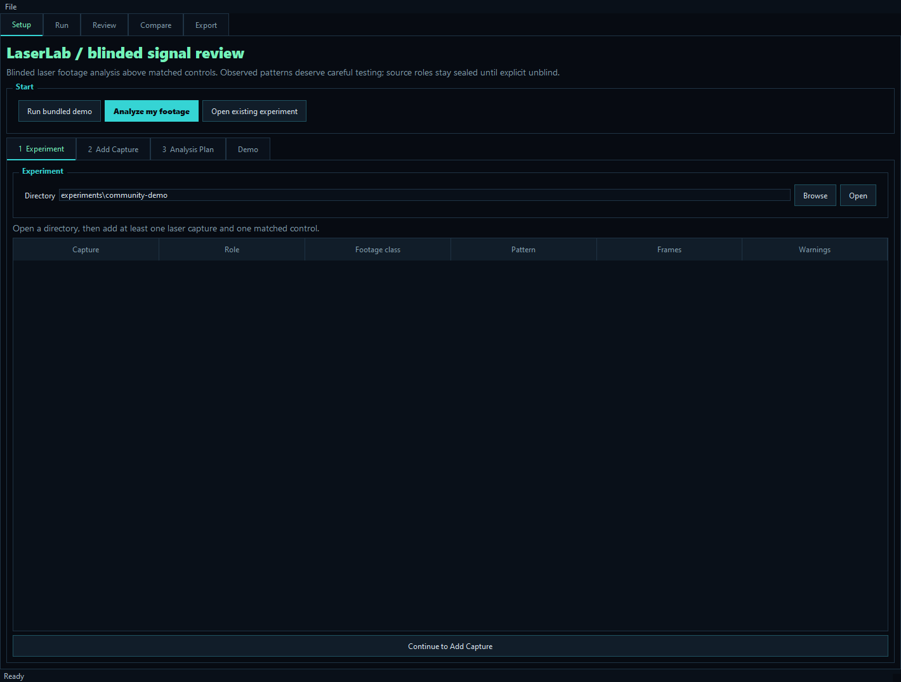
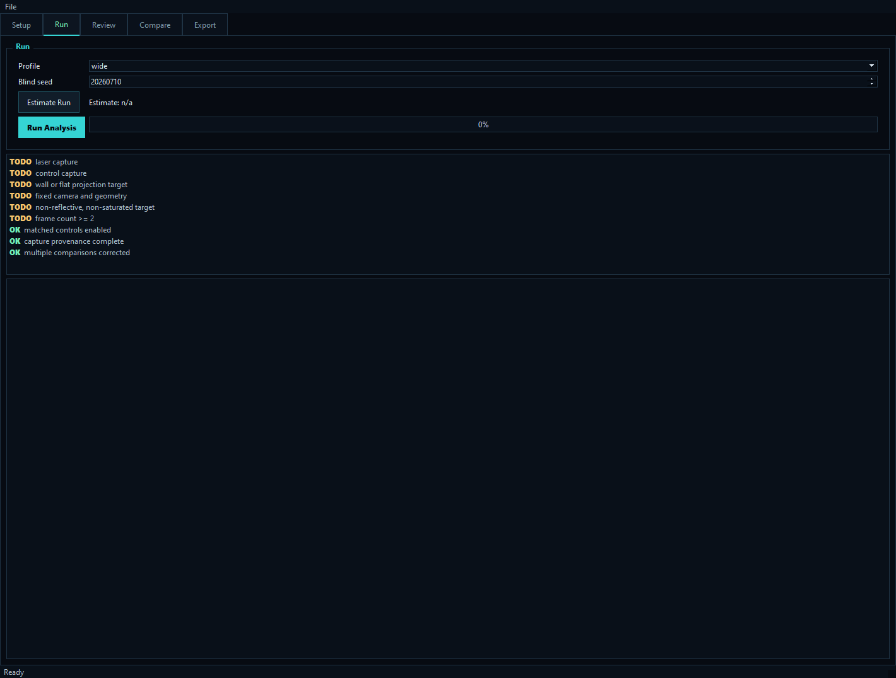
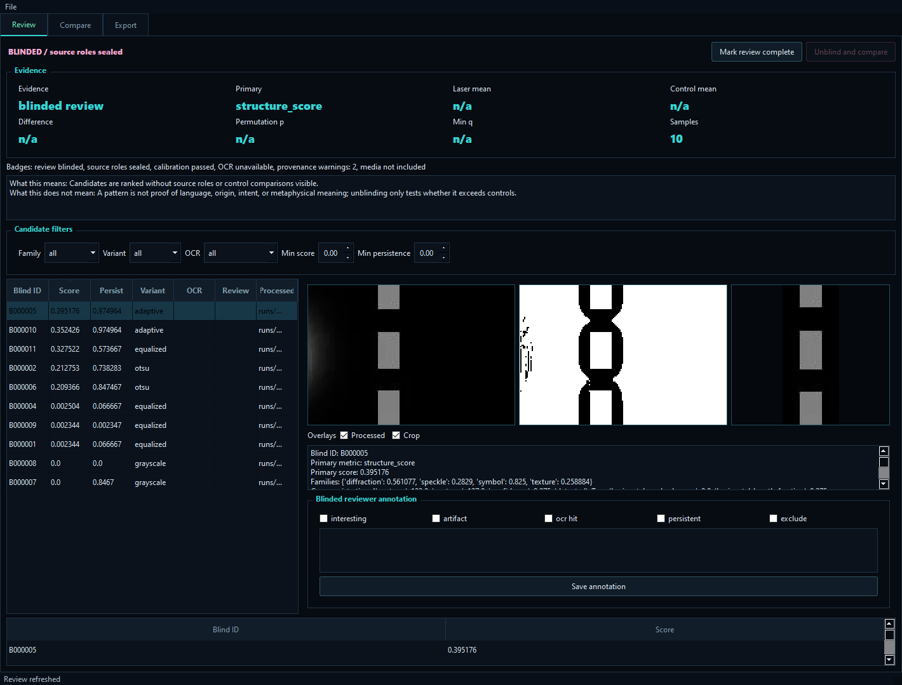
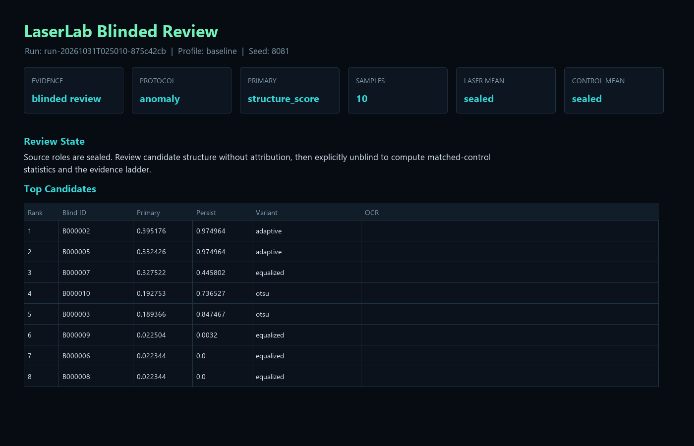

# LaserAnalysisAI

LaserAnalysisAI is now a LaserLab blinded validation lab for laser capture
analysis. It does not claim what a signal "means"; it tests whether existing
image or video captures contain repeatable structured detections above matched
controls.

The main user-facing app is a PyQt5 desktop dashboard. The `laserlab` package
also remains available as a CLI/API path for reproducible experiments, reports,
and statistical comparison.

## LaserLab Dashboard

This source tree builds **LaserLab 0.9.8 development candidates**; the latest published native release is **v0.9.7**. Development builds are identified by commit in `BUILD-INFO.json` and are not official v0.9.8 releases. See [Release status](https://github.com/ProhibitedTV/LaserAnalysisAI/wiki/Release-Status) for publication and qualification progress.

Native release bundles contain:

- `LaserLab` (`LaserLab.exe` on Windows, `LaserLab.app` on macOS): desktop dashboard for experiment setup, runs, review, and export.
- `LaserLabCLI` (`LaserLabCLI.exe` on Windows): command-line interface for scripted workflows.
- `sample_media/`: redistributable public optical/interference fixture clips.
- `BUILD-INFO.json`: version, source commit/tree, candidate/release channel, target and build environment.
- New candidate bundles also include `SHA256SUMS`, with a separate `.zip.sha256` for the archive.

The desktop workflow is deliberately narrow:

- `Setup`: follow Experiment → Add Capture → Analysis Plan → Demo. Wall-projection essentials stay visible; sampling, ROI, hardware detail, psychophysics, and subjective context remain collapsed until requested.
- `Run`: check protocol quality, estimate work, set the blind seed, and score sealed samples.
- `Review`: filter blind IDs, toggle scored ROI overlays, inspect original/processed/crop views and normalized OCR attempts, and save source-safe notes without attribution.
- `Compare`: unlock matched-control and detector-family statistics only after explicit unblind.
- `Export`: create attribution-safe blinded bundles or complete unblinded research bundles.

The dark community-science theme is driven by one shared token module used by both the dashboard and HTML reports. Sealed review, exploratory/insufficient-sample states, warnings, null results, context-only data, and above-control candidates each have a stable status color; color is never the only status indicator.

Field support remains local-first. **Help > System Check** reports packaged-runtime, dependency, fixture, and optional OCR readiness. **Export Support Bundle** writes redacted diagnostics and a sanitized local log without experiment media, capture roles, or source paths. Recent experiment folders are remembered locally, and packaged builds resolve bundled fixtures independently of the directory used to launch the app.






### Optional CodeOfReality display fonts

The **Appearance > Wordmark font** menu supports seven decorative
CodeOfReality variants, plus the system-default typeface. **Authorized native
release builds now include all seven reviewed font binaries automatically**.
Source checkouts contain the seven files in a SHA-256-pinned tar.xz archive
under `assets/codeofreality/`; install them into local user storage using
the command below. You can switch styles from the menu, and the choice is
remembered locally; missing or invalid fonts use the system fallback.

| Menu style | Local font filename |
| --- | --- |
| Classic OTF (default) | `CodeOfRealityV1.otf` |
| Classic TTF | `CodeOfReality.ttf` |
| Circuit | `CodeOfReality-Circuit.ttf` |
| Oracle | `CodeOfReality-Oracle.ttf` |
| Symbols | `CodeOfRealitySymbols 2.ttf` |
| Symbols 3D | `CodeOfRealitySymbols-3D.ttf` |
| Symbols Outline | `CodeOfRealitySymbols-Outline.ttf` |

**Qt font naming:** Symbols 3D and Symbols Outline share the OpenType
typographic family `Code of Reality Symbols` with distinct styles
`3D` and `Outline`. LaserLab selects the requested style explicitly for
its decorative wordmarks rather than silently displaying the Regular face.
The original font bytes are not modified. Native GUI smoke checks both
their family registration and the availability of those named styles.

For a complete verified local installation, put all seven files into one
folder. In the desktop app select **Appearance > Install all seven
CodeOfReality fonts…** and choose that folder. LaserLab verifies the original
SHA-256 for every file, installs locally, refreshes the wordmark and reports
the number of renderable references. This never publishes the fonts and does
**not** automatically enable experimental OCR.

From a source checkout, install directly from the reviewed archive:

```powershell
python -m laserlab.cli font-install --archive "assets\\codeofreality\\CodeOfReality-authorized-fonts.tar.xz"
```

You can also install from a separate folder of the original files (the
uploaded `CodeOfRealityV1.otf_1` filename is accepted and renamed):

```powershell
python -m laserlab.cli font-install --source "C:\\Research\\CodeOfRealityFonts"
```

The installer checks every file against the reviewed SHA-256 manifest before
copying anything, refuses to overwrite a different installed font, and reports
how many fonts were installed. It never uploads them to a network service.

To qualify the complete installed font family for OCR, run:

```powershell
python -m laserlab.cli font-verify --require-all
```

This checks every installed font's fingerprint and verifies that the expected
character templates can be rasterized. It prints a JSON report with a separate
status for missing, altered, unreadable or verified fonts, without exposing
private local paths. A complete inspection reports `verified_variants: 7`
and `all_verified: true`. This **does not measure OCR accuracy** on real
laser footage.

To reproduce a fuller synthetic glyph self-consistency benchmark using all
seven fonts (across the 96, 64, 40 and 24 px reference sizes), run:

```powershell
python -m laserlab.cli font-calibrate --variant all
```

This prints per-font counts of correct matches, incorrect matches, abstentions,
unrenderable samples, and separate counts of rejections, false accepts and failed
attempts on three deterministic synthetic negative controls (blank, uniform and
seeded noise). A failed or unavailable OCR attempt is not a successful rejection;
any engine failure marks that variant incomplete and makes the CLI exit nonzero.
A completed calibration still does not imply accurate recognition. The samples are created
**from the same fonts that generate the OCR templates**, not from independent
capture footage, so this is a software calibration check only. It deliberately
reports `empirical_accuracy_validated: false` and
`independent_laser_capture_count: 0`, regardless of how many synthetic
matches succeed. Do not present it as accuracy on actual laser recordings.

Local installation directories:

- Windows: `%LOCALAPPDATA%\\LaserLab\\fonts\\`
- macOS: `~/Library/Application Support/LaserLab/fonts/`
- Linux: `~/.local/state/laserlab/fonts/` (or `$XDG_STATE_HOME/laserlab/fonts/`)

Alternatively, set `LASERLAB_BRAND_FONT_PATH` to the full path of a Classic
OTF file before starting the app. That override applies to the **Classic OTF**
menu entry for backwards compatibility.

As UI typefaces, these fonts are limited to the lowercase `laserlab` wordmark,
**not** scientific values, tables, OCR output text, or experiment labels.
Separately, all seven can serve as glyph references for the optional OCR
comparison adapter below. The symbol
variants map some normal letters to pictographs and are not suitable for
ordinary interface text. Classic OTF/TTF omit most punctuation and numerals.

### Experimental CodeOfReality reference-glyph OCR

The full seven-font family can now serve as a set of **local reference shapes**
for an optional OCR comparison adapter. These files do not become a Tesseract
language model simply by installing them. The experimental adapter renders
glyph templates from the locally installed font and attempts exact-looking
matches to **high-contrast, isolated, separated glyphs** in selected image
regions. It deliberately **abstains** if a crop is noisy, crowded, ambiguous,
or too different from a known reference.

Try it with one local image (without sending the image to a network service):

```powershell
python -m laserlab.cli font-ocr --image C:\\Research\\glyph-test.png --variant all
```

The standalone command reports `comparison_complete` separately from any match.
Exit code 0 means all requested variants completed (including valid abstentions);
exit code 2 means at least one engine failed or was unavailable. JSON retains all
attempts in either case. A match or completed comparison does not validate
recognition accuracy, and a user-supplied image is not assumed to have known text.

To also include these experiments in the regular blinded analysis pipeline,
turn on **Appearance > Compare CodeOfReality glyphs (experimental)** in the
desktop app before starting a new run (this switch is session-only).
Alternatively, opt in before launching LaserLab or running its CLI:

```powershell
$env:LASERLAB_FONT_OCR_VARIANTS = "all"   # or "classic,circuit,oracle"
python main.py
```

Results are recorded as separate `codeofreality-template:<variant>` entries in
the OCR attempt audit trail, and appear in the **Review** candidate details
with an explicit experimental label. **They do not replace Tesseract or
contribute to the primary structure score or primary OCR agreement.**
Font variants are correlated reference comparisons, not independent
confirmation votes. Multi-scale references are rendered at 96, 64, 40 and
24 px to reduce small-glyph aliasing. A matched font silhouette is not a decoded
message, language identification, or evidence of an external source. In
particular, uppercase and lowercase Symbols glyphs are identical; the
adapter only emits lowercase canonical labels. Classic supports `a-z1234`;
Symbols supports `a-z1234567`; Circuit and Oracle additionally support
uppercase, numerals, and brackets. No validated accuracy on real-world laser
footage is claimed. More advanced segmentation, robustness testing, false
positive controls, and independent external validation remain necessary.

### Troubleshooting "English instead of .ttf OCR"

**Tesseract and CodeOfReality are different OCR engines.** Tesseract uses
traineddata models (normally `eng` for English), not font files. The opt-in
CodeOfReality matcher uses the seven locally installed and checked font files
as shape templates; it can abstain on noisy or overlapping glyphs and does not
decode a validated language. Installing a decorative font or selecting a
wordmark changes neither Tesseract's language nor the experimental OCR mode.

For a report that only shows English OCR output:

1. Check **Help > System Check** and the **About** version in the GUI. New
   builds after [issue #96](https://github.com/ProhibitedTV/LaserAnalysisAI/issues/96)
   report CodeOfReality selection and per-font reference readiness separately
   from Tesseract. The published **v0.9.7** release does not yet include this
   expanded System Check; verify which build actually ran. A previous source
   checkout or an older app folder can coexist with a newer download.
2. In a source checkout, run `python -m laserlab.cli font-verify --require-all`
   to verify all seven reviewed references. In a native release, use its
   packaged `LaserLabCLI font-verify --require-all` executable.
   `verified_variants: 7` and `all_verified: true` mean the fonts are
   renderable, **not** that real recordings have passed recognition tests.
3. For a *new* dashboard analysis, explicitly select **Appearance > Compare
   CodeOfReality glyphs (experimental)**. This option is session-only and
   affects the next run, not previously saved candidate records. For a
   standalone synthetic high-contrast image, use
   `python -m laserlab.cli font-ocr --image <image-file> --variant all`.
4. In **Review**, look for `codeofreality-template:<variant>` in the OCR
   attempts. A `tesseract` attempt with language `eng` is not a substitute.
   Missing template attempts mean no such attempt was recorded for that
   candidate, not necessarily that a font was corrupted. Explicit unavailable
   or no-match outcomes should be preserved rather than treated as a fallback
   to English.
5. For reproducible support, record the OS, exact app version, CLI command
   or clicks, and which engine ID was shown. Export only **Help > Export
   Support Bundle**, review its redacted diagnostics before sharing, and
   keep original recordings and review exports private.

The local CLI also provides `python -m laserlab.cli diagnostics --format json`.
New builds report `ocr.codeofreality.selection`, `selected_variants`,
`verified_variants`, and `variant_statuses` without user font paths.
Version/release comparisons must use the actual built executable, not the
README version alone.

### Reported-symbol / laser-light comparison (experimental)

You can compare **one cropped laser-light shape** against **one separately
supplied image** of a symbol someone has reported seeing during a DMT
experience. Optionally include up to **32 separate control laser crops** to
describe a background distribution of visual similarities. The image files
are processed locally; none are bundled, shared, or uploaded by LaserLab:

```powershell
python -m laserlab.cli symbol-compare \
  --laser-image "C:\\Research\\laser-crop.png" \
  --reported-symbol-image "C:\\Research\\reported-symbol.png" \
  --control-laser-image "C:\\Research\\control-01.png" \
  --control-laser-image "C:\\Research\\control-02.png" \
  --variant all
```

For initial experimentation without a locally installed Tesseract executable,
add `--no-tesseract`. Otherwise the command records Tesseract's **separate,
untrained** output for both crops. The opt-in CodeOfReality reference matcher
tries all seven font variants independently on each image, and reports possible
shared reference labels without treating correlated font variants as
independent votes. The original images are not exported.

The JSON output includes two **descriptive** image-shape metrics:
`normalized_pixel_difference` (smaller means more alike after foreground
cropping and rescaling) and `foreground_intersection_over_union` (larger
means greater binary shape overlap). If controls are supplied, the report records each comparison separately,
plus the median control distance, how many controls looked more/less similar
than the primary laser crop, and the **descriptive fraction** of controls
at least as visually similar as the primary crop. The old `laser_control`
field remains available for a single control; multiple controls appear under
`control_comparisons` and `control_summary`. The new fraction is **not a
p-value**: the program cannot verify independent samples, blinded selection,
or matching camera/capture conditions. It still reports
`statistical_significance_estimated: false` and
`matched_negative_controls: 0` regardless of how many unverified control
crops were supplied. No statistical significance, language, meaning, DMT
mechanism or common origin is inferred. Blank, oversized, or unstructured
images may produce an explicit `unavailable` outcome instead of a false
match.

For reliable scientific comparison, obtain independently documented symbol
references with their source/context, predefine image crop locations and shape
thresholds before unblinding, add camera-matched negative-control recordings,
and repeat with independently acquired data. A font inspired by reported
experiences is a reference-shape library, **not** a validated map of
experiences or a cipher key. See
[the distribution attestation](docs/CODEOFREALITY_DISTRIBUTION_ATTESTATION.md)
for the maintainer-reported creator authorization.

### Authorized release packaging

The exact seven supplied fonts are **now committed to GitHub**, as a single
checksum-pinned compressed source asset:

`assets/codeofreality/CodeOfReality-authorized-fonts.tar.xz`

The maintainer stated on November 19, 2026, that they received direct
permission from the creator over Discord and explicitly authorized these
fonts' integration into GitHub and LaserLab releases. That statement is
recorded in
[the distribution attestation](docs/CODEOFREALITY_DISTRIBUTION_ATTESTATION.md).
We have **not** inspected the original Discord message or an independent
license grant. Classic font metadata credits Chris Johnson (2026); the
Symbols family identifies Luke Hearn as a designer. Retain applicable
attributions and any additional distribution terms.

**Ordinary native builds from this branch now stage all seven fonts by
default.** The builder validates the exact compressed-archive SHA-256,
extracts only the seven expected regular files, verifies their individual
SHA-256 values, and includes them and the maintainer-attestation text in
both PyInstaller applications and the ZIP archive. A packaged
`font-verify --require-all` smoke test must pass before the ZIP is finalized.

```powershell
python scripts/build_release.py
```

Advanced release operators can still override the vendored archive by
providing a separately authorized font directory and a UTF-8
`CODEOFREALITY-PERMISSION.txt` rights notice. For that override, both
environment variables remain required:

```powershell
$env:LASERLAB_RELEASE_FONTS_DIR = "C:\\ApprovedCodeOfRealityFonts"
$env:LASERLAB_FONT_REDISTRIBUTION_CONFIRMED = "yes"
python scripts/build_release.py
```

See [the permission guide](docs/CODEOFREALITY_PERMISSION_GUIDE.md) for the
recordkeeping checklist. Bundling glyph shapes does not turn Tesseract into
a CodeOfReality-trained model and does not validate symbols from captured
laser light. Native release artifacts and independently obtained field
data still require separate acceptance testing.

## Community and Support

New to the project? Browse the [LaserLab Wiki](https://github.com/ProhibitedTV/LaserAnalysisAI/wiki), [Getting Started](https://github.com/ProhibitedTV/LaserAnalysisAI/wiki/Getting-Started), and [FAQ](https://github.com/ProhibitedTV/LaserAnalysisAI/wiki/FAQ). Community guides are maintained in the Wiki's separate repository.

- [GitHub Discussions](https://github.com/ProhibitedTV/LaserAnalysisAI/discussions): questions, experiment design, and community conversation.
- [Report a bug or suggest a feature](https://github.com/ProhibitedTV/LaserAnalysisAI/issues/new/choose): structured issue forms.
- [Contributing](CONTRIBUTING.md), [Support](SUPPORT.md), [Code of Conduct](CODE_OF_CONDUCT.md), and [Security](SECURITY.md).

## Veilbreak Community Research Companion

LaserLab can optionally **browse published Veilbreak protocols and experiments** from its desktop interface, then link selected records to a local experiment as context-only metadata. This does not require a Veilbreak login, send recordings to the network, or change detector scores. The live MCP service is external and may be unavailable; local imports remain supported.

**[Read the Veilbreak integration guide](docs/VEILBREAK_INTEGRATION.md)** for the current functionality, limitations, privacy boundaries, and future collaboration plan.

**Want a Veilbreak REST API key for your own tools?** Choose **Help > Get optional Veilbreak API key** (or the button in Export's community data tools). This opens Veilbreak's official [API Access page](https://veilbreak.ai/api-access), where you request the key yourself. An email address is required; no account is needed. Veilbreak documents one active key per email and 30-day expiry. LaserLab never requests, receives, or stores keys, and **its public MCP catalog doesn't need one**.

## Quick Start

See the [Researcher Workflow](docs/researcher_workflow.md) for the complete dashboard flow, capture guidance, interpretation rules, sharing steps, and platform troubleshooting.

Use Python 3.10 or 3.11. On this workstation, the preferred interpreter is:

```powershell
$PY = "C:\Users\RhythmicCarnage\AppData\Local\Programs\Python\Python310\python.exe"
& $PY -m pip install -r requirements.txt
```

Run the dashboard from source:

```powershell
& $PY main.py
```

Run tests:

```powershell
& $PY -m unittest discover -s tests
```

Check an installation or create a local support bundle with path redaction. Review its diagnostics and log before sharing:

```powershell
& $PY -m laserlab.cli diagnostics --format json
& $PY -m laserlab.cli support-bundle --output LaserLab-support.zip
```

Run the bundled demo through the same API layer used by the dashboard:

```powershell
.\scripts\run_fixture_demo.ps1 -Experiment experiments\release-demo -MaxFrames 2 -Profile wide -Protocol anomaly
```

## Protocol Presets

- `Diffraction / interference`: 2D FFT spectrum, fringe spacing proxy, peak/ring stability.
- `Laser speckle / scatter`: spatial speckle contrast, local variance, temporal stability proxy.
- `OCR / symbol recovery`: scored code-like ROIs, normalized optional OCR attempts, connected components, and synthetic known-text calibration.
- `General anomaly scan`: broad texture, edge, OCR, and persistence sweep with strict false-positive language.

Each preset writes a sealed review first. The manifest, report, results, CSV, HTML, and review bundle omit labels, source paths, provenance, and raw media. Setup and Run remain locked until the reviewer marks inspection complete and explicitly chooses **Unblind and compare**.

## Primary Capture Model

LaserLab is designed first for already-recorded wall-projection experiments: a fixed laser and optional diffraction layer projecting onto a wall or flat non-reflective target, recorded by a fixed camera alongside matched controls. Public educational clips and bundled optical videos are calibration, regression, and demo fixtures; they are not substitutes for matched wall-projection footage.

Capture metadata records the projection surface, laser pattern, wavelength, fixed geometry, saturation status, optical layer, room lighting, power/class labels, and safety acknowledgement. `cross` is a first-class pattern type, with presets for commonly reported 650, 532, 488, 450, and 405 nm hardware metadata. Entered labels are reports, not verified measurements.

The detector now registers visible cross arms, center, rotation, arm coverage, saturation, and center/horizontal/vertical ROIs. These are image measurements, not evidence that a pattern is language or has an external origin.

Code-like ROI proposals combine connected components, repeated contour geometry, edge/line density, high-frequency texture bands, grid regularity, local contrast, non-max suppression, and frame persistence. Every retained ROI stores its reasons, scores, bounding mask, original/processed crops, and parent preprocessing variant. Tesseract remains optional and runs through a normalized adapter contract; empty, unavailable, timed-out, and failed attempts stay in the record instead of disappearing. OCR text remains a detector output, not a language claim.

Optional subjective context is kept in a separate `context_only` record. It remains sealed during candidate review and never contributes to detector scores, p-values, or the evidence ladder.

## Falsification And Community Data

The advanced Analysis Plan can import a pre-declared yes/no trial file in JSON or CSV format. LaserLab reports hit, miss, false-alarm, and correct-rejection rates, d-prime, response criterion, balanced accuracy, Wilson intervals, and the correction used for extreme rates. Psychophysics results remain sealed until unblind and never alter image-detector scores.

Every unblinded report includes an explicit falsification matrix. Tested and not-tested rows cover participant sensitivity and bias, matched-control detector evidence, gaze/wall stability, parallax, focus, binocular consistency, polarization, carrier grids, wavelength/surface controls, transcription null models, cross-domain correspondence, and independent replication. A successful row is a bounded test result, not proof of origin.

Export contains an optional collapsed local-data panel for user-supplied community JSON/CSV and pseudonymous symbol transcriptions. Imports are hashed, allow-listed, privacy-labeled, and context-only. Network URLs are rejected; substance/dose fields are filtered rather than converted into guidance; no account, upload, scraping, API key, or Veilbreak dependency is required.

## CLI Workflow

Create or append captures to an experiment:

```powershell
& $PY -m laserlab.cli init --source C:\captures\laser --kind image-set --label laser --experiment experiments\trial-001
& $PY -m laserlab.cli init --source C:\captures\control --kind image-set --label matched_control --experiment experiments\trial-001
```

For video sources, use `--all-frames` to turn the frame dial fully open:

```powershell
& $PY -m laserlab.cli init --source C:\captures\laser.mp4 --kind video --label laser --experiment experiments\trial-001 --sampling-profile wide --all-frames --max-frames 500
```

Sampling profiles are `quick`, `baseline`, `wide`, and `exhaustive`. Near-duplicate frames are suppressed by default using perceptual similarity plus brightness tolerance; use `--keep-duplicates` only when repeated identical frames are part of the planned analysis. `--sampling-mode scene_change` is available for long recordings with sparse transitions.

Run blinded analysis:

```powershell
& $PY -m laserlab.cli run --experiment experiments\trial-001 --profile baseline --blind-seed 123
```

After candidate review is complete, explicitly reveal attribution and compute matched-control statistics:

```powershell
& $PY -m laserlab.cli unblind --experiment experiments\trial-001
```

Run a wider preprocessing sweep:

```powershell
& $PY -m laserlab.cli run --experiment experiments\trial-001 --profile wide --protocol diffraction --blind-seed 123
```

Regenerate the latest report:

```powershell
& $PY -m laserlab.cli report --experiment experiments\trial-001 --format both
```

List or describe protocol presets:

```powershell
& $PY -m laserlab.cli protocols list
& $PY -m laserlab.cli protocols describe speckle
```

Export a local-first community review bundle:

```powershell
& $PY -m laserlab.cli bundle --experiment experiments\trial-001 --output exports\trial-001-review.zip
```

For an unblinded experiment containing participant, subjective, or imported community context, review privacy and redaction first, then add `--acknowledge-privacy`.

List or fetch fixture media:

```powershell
& $PY -m laserlab.cli fixtures list --include-restricted
& $PY -m laserlab.cli fixtures fetch --output sample_media
```

## Outputs

- `manifest.json`: stable experiment record with sources, captures, raw/frame hashes, media metadata, provenance warnings, deterministic sampling settings, preprocessing profiles, detector settings, protocol plan, ROI, optional sealed psychophysics/community context, blinding seed, and output paths.
- `runs/<run-id>/results.json`: sealed detector records, ROI boxes/masks/crops/overlays, and normalized OCR attempts before unblind; after explicit unblind it gains source roles, attribution, source-class diagnostics, and independent capture-pair statistics. Candidate q-values remain unset because related frames and variants do not provide a calibrated candidate-level null.
- `runs/<run-id>/report.html`: human-readable evidence summary with original, processed, ROI-overlay, and crop views plus blinded reviewer annotations, provenance after unblind, and null-result language.
- `*.zip` review bundle: blinded bundles exclude source attribution and media; unblinded bundles can include provenance and optional raw media.

## Evidence Ladder

Reports classify each run into one of these levels:

- `not tested`: no suitable declared empirical comparison or independent design was established. This is exploratory, not a negative finding.
- `insufficient independent samples`: fewer than five declared independent matched capture pairs; more frames do not supply independent replication.
- `no signal`: a supported capture-pair comparison did not clear the selected threshold.
- `artifact`: detections are better explained by controls or weak differences.
- `anomaly`: elevated structure exists, but not enough for a controlled claim.
- `above-control candidate`: capture-pair scores exceed the declared empirical matched controls under the documented paired permutation test.

Generated negatives, sensor noise, unrelated controls, public demo clips, and synthetic positives are separate diagnostics. They cannot substitute for empirical matched recordings. Frame persistence never promotes a run to `repeatable candidate`; independent replication remains a separate research question.

See [Statistical inference and saved-run compatibility](docs/statistical_inference.md) for independent-pair declarations, exchangeability assumptions, the minimum-replicate rule, and legacy-report handling. Use the version recorded in a report to identify its analysis method. The independent-pair method starts in 0.9.0.

The system is intentionally conservative. A null result means this detector set
and capture set did not beat the control baseline, not that the broader idea is
disproven.

## Fixtures

The fixture catalog includes small Wikimedia Commons optical/interference videos
with explicit Creative Commons licensing, plus an external pointer to the
Illinois Wesleyan/American Journal of Physics single-photon video set. The IWU
set is scientifically stronger but stays external/manual until redistribution
terms are confirmed.

See the [Fixture Catalog](docs/fixture_catalog.md) for expected detector behavior, limitations, licenses, and provenance rules.

LaserLab 0.9.0 includes a small offline [optical benchmark](docs/optical_benchmark.md) with ten synthetic cases, blur and JPEG probes, explicit ground truth, raw and processed hashes, and recorded false-positive baselines. It keeps optical artifacts and optional OCR responses separate from empirical evidence.

## Capture Better Footage

- Capture laser and control footage under matched camera settings, exposure, focus, distance, and surface geometry.
- Include non-diffracted laser/control footage where possible, not only blank frames.
- Avoid saturated frames; if the beam is clipped to pure white/green, many metrics become less meaningful.
- Use a stable camera or tripod so persistence and phase-registration scores are interpretable.
- Record enough frames for both laser and controls. Two frames is fine for smoke tests; real runs need more.

## Interpret Null Results

A null result is useful. It means the selected protocol, detector sweep, and capture set did not exceed matched controls under this run. It does not prove absence of a signal, and it does not settle origin claims. Repeat new blinded captures before treating any candidate as meaningful.

## What LaserLab Cannot Prove

LaserLab cannot prove metaphysical origin, intent, consciousness interaction, or that any detected structure is language. It can only report whether detector scores exceed matched controls under a reproducible local protocol.

## Build Native Release

The shared builder requires a clean Git checkout and produces a native archive for the current host platform:

```text
python scripts/build_release.py --output-dir dist
```

Windows users can use the compatibility wrapper:

```powershell
.\scripts\build_windows_exe.ps1 -OutputDir dist
```

Untagged builds are unpublished candidates, identified by source revision:

```text
dist/LaserLab-v<version>-candidate-<source>-<platform>-<architecture>.zip
```

Existing outputs and build folders are preserved; choose a fresh output directory when repeating the same candidate. Build resources are limited to declared redistributable fixtures and their metadata. `BUILD-INFO.json` records the exact clean source; file and archive checksums identify the produced bytes.

GitHub Actions runs the supported Python suites before building/smoke-testing all four platforms. Manual workflow runs stage candidate artifacts without publishing a release. Tag builds require `v<version>` to match the application version and exact checked-out commit; they stage a **draft**, with nonfinal versions marked as prereleases. Native UI qualification of the actual artifacts is required before publishing that draft. See [release qualification](docs/release_qualification.md).

Tesseract remains optional at runtime; OCR is reported as unavailable when the external Tesseract executable is not installed.

## Legacy Viewer Status

The old single-column OCR viewer has been retired from the primary app path.
Legacy helper modules remain in the repo where they still support compatibility,
but new development should target the `laserlab` engine and the LaserLab
dashboard.
