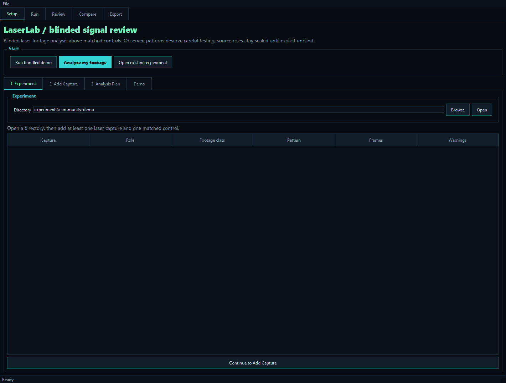
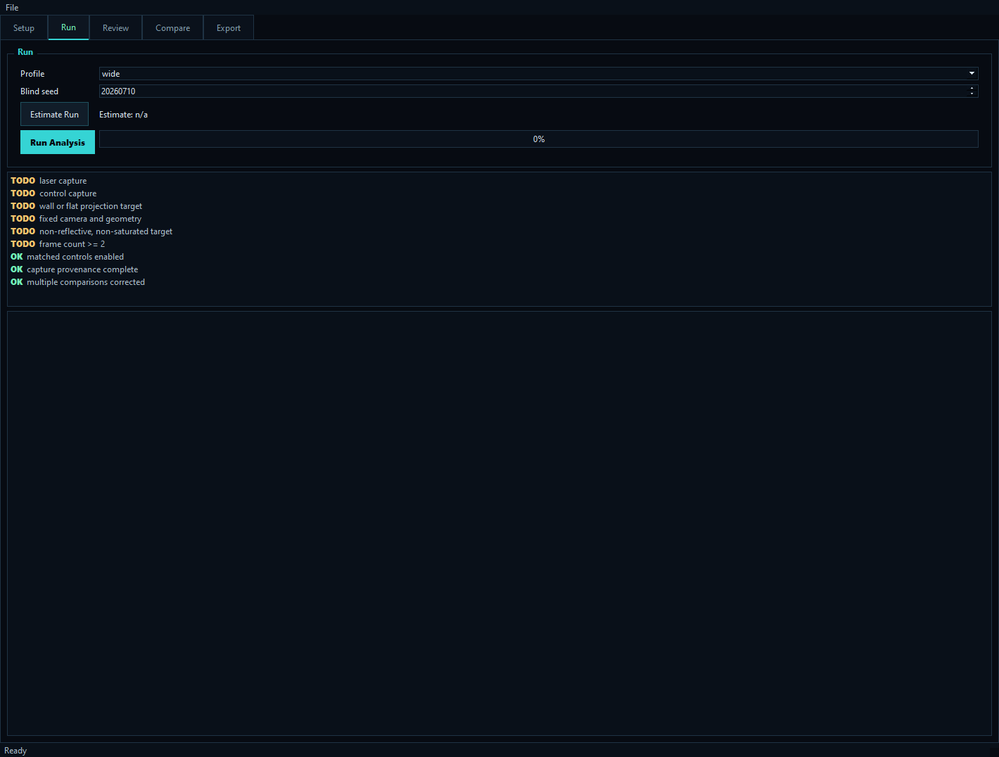
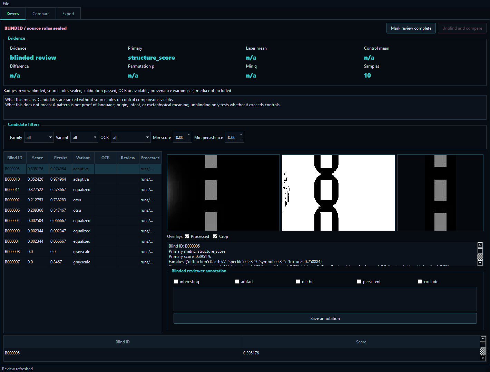
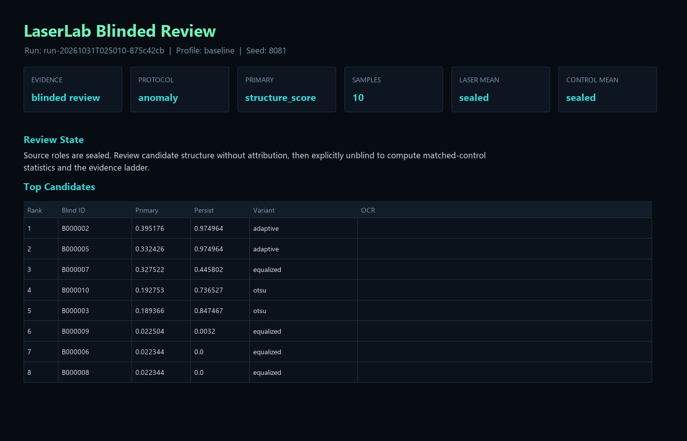

# LaserAnalysisAI

LaserAnalysisAI is now a LaserLab blinded validation lab for laser capture
analysis. It does not claim what a signal "means"; it tests whether existing
image or video captures contain repeatable structured detections above matched
controls.

The main user-facing app is a PyQt5 desktop dashboard. The `laserlab` package
also remains available as a CLI/API path for reproducible experiments, reports,
and statistical comparison.

## LaserLab v0.8.1 Dashboard

Native release bundles contain:

- `LaserLab` (`LaserLab.exe` on Windows, `LaserLab.app` on macOS): desktop dashboard for experiment setup, runs, review, and export.
- `LaserLabCLI` (`LaserLabCLI.exe` on Windows): command-line interface for scripted workflows.
- `sample_media/`: redistributable public optical/interference fixture clips.
- `BUILD-INFO.json`: exact version, target, Python, operating system, and CPU architecture used for the build.

The desktop workflow is deliberately narrow:

- `Setup`: follow Experiment → Add Capture → Analysis Plan → Demo. Wall-projection essentials stay visible; sampling, ROI, hardware detail, psychophysics, and subjective context remain collapsed until requested.
- `Run`: check protocol quality, estimate work, set the blind seed, and score sealed samples.
- `Review`: filter blind IDs, toggle scored ROI overlays, inspect original/processed/crop views and normalized OCR attempts, and save source-safe notes without attribution.
- `Compare`: unlock matched-control and detector-family statistics only after explicit unblind.
- `Export`: create attribution-safe blinded bundles or complete unblinded research bundles.

The dark community-science theme is driven by one shared token module used by both the dashboard and HTML reports. Sealed review, warnings, null results, context-only data, above-control candidates, and repeatable candidates each have a stable status color; color is never the only status indicator.






## Quick Start

See the [Researcher Workflow](docs/researcher_workflow.md) for the complete dashboard flow, capture guidance, interpretation rules, sharing steps, and platform troubleshooting.

Use Python 3.10 or 3.11. On this workstation, the preferred interpreter is:

```powershell
$PY = "C:\Users\RhythmicCarnage\AppData\Local\Programs\Python\Python310\python.exe"
& $PY -m pip install -r requirements.txt
```

Run the dashboard from source:

```powershell
& $PY main.py
```

Run tests:

```powershell
& $PY -m unittest discover -s tests
```

Run the bundled demo through the same API layer used by the dashboard:

```powershell
.\scripts\run_fixture_demo.ps1 -Experiment experiments\release-demo -MaxFrames 2 -Profile wide -Protocol anomaly
```

## Protocol Presets

- `Diffraction / interference`: 2D FFT spectrum, fringe spacing proxy, peak/ring stability.
- `Laser speckle / scatter`: spatial speckle contrast, local variance, temporal stability proxy.
- `OCR / symbol recovery`: scored code-like ROIs, normalized optional OCR attempts, connected components, and synthetic known-text calibration.
- `General anomaly scan`: broad texture, edge, OCR, and persistence sweep with strict false-positive language.

Each preset writes a sealed review first. The manifest, report, results, CSV, HTML, and review bundle omit labels, source paths, provenance, and raw media. Setup and Run remain locked until the reviewer marks inspection complete and explicitly chooses **Unblind and compare**.

## Primary Capture Model

LaserLab is designed first for already-recorded wall-projection experiments: a fixed laser and optional diffraction layer projecting onto a wall or flat non-reflective target, recorded by a fixed camera alongside matched controls. Public educational clips and bundled optical videos are calibration, regression, and demo fixtures; they are not substitutes for matched wall-projection footage.

Capture metadata records the projection surface, laser pattern, wavelength, fixed geometry, saturation status, optical layer, room lighting, power/class labels, and safety acknowledgement. `cross` is a first-class pattern type, with presets for commonly reported 650, 532, 488, 450, and 405 nm hardware metadata. Entered labels are reports, not verified measurements.

The detector now registers visible cross arms, center, rotation, arm coverage, saturation, and center/horizontal/vertical ROIs. These are image measurements, not evidence that a pattern is language or has an external origin.

Code-like ROI proposals combine connected components, repeated contour geometry, edge/line density, high-frequency texture bands, grid regularity, local contrast, non-max suppression, and frame persistence. Every retained ROI stores its reasons, scores, bounding mask, original/processed crops, and parent preprocessing variant. Tesseract remains optional and runs through a normalized adapter contract; empty, unavailable, timed-out, and failed attempts stay in the record instead of disappearing. OCR text remains a detector output, not a language claim.

Optional subjective context is kept in a separate `context_only` record. It remains sealed during candidate review and never contributes to detector scores, p-values, or the evidence ladder.

## Falsification And Community Data

The advanced Analysis Plan can import a pre-declared yes/no trial file in JSON or CSV format. LaserLab reports hit, miss, false-alarm, and correct-rejection rates, d-prime, response criterion, balanced accuracy, Wilson intervals, and the correction used for extreme rates. Psychophysics results remain sealed until unblind and never alter image-detector scores.

Every unblinded report includes an explicit falsification matrix. Tested and not-tested rows cover participant sensitivity and bias, matched-control detector evidence, gaze/wall stability, parallax, focus, binocular consistency, polarization, carrier grids, wavelength/surface controls, transcription null models, cross-domain correspondence, and independent replication. A successful row is a bounded test result, not proof of origin.

Export contains an optional collapsed local-data panel for user-supplied community JSON/CSV and pseudonymous symbol transcriptions. Imports are hashed, allow-listed, privacy-labeled, and context-only. Network URLs are rejected; substance/dose fields are filtered rather than converted into guidance; no account, upload, scraping, API key, or Veilbreak dependency is required.

## CLI Workflow

Create or append captures to an experiment:

```powershell
& $PY -m laserlab.cli init --source C:\captures\laser --kind image-set --label laser --experiment experiments\trial-001
& $PY -m laserlab.cli init --source C:\captures\control --kind image-set --label matched_control --experiment experiments\trial-001
```

For video sources, use `--all-frames` to turn the frame dial fully open:

```powershell
& $PY -m laserlab.cli init --source C:\captures\laser.mp4 --kind video --label laser --experiment experiments\trial-001 --sampling-profile wide --all-frames --max-frames 500
```

Sampling profiles are `quick`, `baseline`, `wide`, and `exhaustive`. Near-duplicate frames are suppressed by default using perceptual similarity plus brightness tolerance; use `--keep-duplicates` only when repeated identical frames are part of the planned analysis. `--sampling-mode scene_change` is available for long recordings with sparse transitions.

Run blinded analysis:

```powershell
& $PY -m laserlab.cli run --experiment experiments\trial-001 --profile baseline --blind-seed 123
```

After candidate review is complete, explicitly reveal attribution and compute matched-control statistics:

```powershell
& $PY -m laserlab.cli unblind --experiment experiments\trial-001
```

Run a wider preprocessing sweep:

```powershell
& $PY -m laserlab.cli run --experiment experiments\trial-001 --profile wide --protocol diffraction --blind-seed 123
```

Regenerate the latest report:

```powershell
& $PY -m laserlab.cli report --experiment experiments\trial-001 --format both
```

List or describe protocol presets:

```powershell
& $PY -m laserlab.cli protocols list
& $PY -m laserlab.cli protocols describe speckle
```

Export a local-first community review bundle:

```powershell
& $PY -m laserlab.cli bundle --experiment experiments\trial-001 --output exports\trial-001-review.zip
```

For an unblinded experiment containing participant, subjective, or imported community context, review privacy and redaction first, then add `--acknowledge-privacy`.

List or fetch fixture media:

```powershell
& $PY -m laserlab.cli fixtures list --include-restricted
& $PY -m laserlab.cli fixtures fetch --output sample_media
```

## Outputs

- `manifest.json`: stable experiment record with sources, captures, raw/frame hashes, media metadata, provenance warnings, deterministic sampling settings, preprocessing profiles, detector settings, protocol plan, ROI, optional sealed psychophysics/community context, blinding seed, and output paths.
- `runs/<run-id>/results.json`: sealed detector records, ROI boxes/masks/crops/overlays, and normalized OCR attempts before unblind; after explicit unblind it gains source roles, attribution, q-values, and aggregate comparison statistics.
- `runs/<run-id>/report.html`: human-readable evidence summary with original, processed, ROI-overlay, and crop views plus blinded reviewer annotations, provenance after unblind, and null-result language.
- `*.zip` review bundle: blinded bundles exclude source attribution and media; unblinded bundles can include provenance and optional raw media.

## Evidence Ladder

Reports classify each run into one of these levels:

- `no signal`: laser scores did not exceed matched controls.
- `artifact`: detections are better explained by controls or weak differences.
- `anomaly`: elevated structure exists, but not enough for a controlled claim.
- `above-control candidate`: laser captures beat controls under permutation
  testing and effect-size thresholds.
- `repeatable candidate`: above-control evidence plus frame-to-frame persistence.

The system is intentionally conservative. A null result means this detector set
and capture set did not beat the control baseline, not that the broader idea is
disproven.

## Fixtures

The fixture catalog includes small Wikimedia Commons optical/interference videos
with explicit Creative Commons licensing, plus an external pointer to the
Illinois Wesleyan/American Journal of Physics single-photon video set. The IWU
set is scientifically stronger but stays external/manual until redistribution
terms are confirmed.

See the [Fixture Catalog](docs/fixture_catalog.md) for expected detector behavior, limitations, licenses, and provenance rules.

## Capture Better Footage

- Capture laser and control footage under matched camera settings, exposure, focus, distance, and surface geometry.
- Include non-diffracted laser/control footage where possible, not only blank frames.
- Avoid saturated frames; if the beam is clipped to pure white/green, many metrics become less meaningful.
- Use a stable camera or tripod so persistence and phase-registration scores are interpretable.
- Record enough frames for both laser and controls. Two frames is fine for smoke tests; real runs need more.

## Interpret Null Results

A null result is useful. It means the selected protocol, detector sweep, and capture set did not exceed matched controls under this run. It does not prove absence of a signal, and it does not settle origin claims. Repeat new blinded captures before treating any candidate as meaningful.

## What LaserLab Cannot Prove

LaserLab cannot prove metaphysical origin, intent, consciousness interaction, or that any detected structure is language. It can only report whether detector scores exceed matched controls under a reproducible local protocol.

## Build Native Release

The shared builder runs on Windows, macOS, or Linux and produces a native archive for the host platform:

```text
python scripts/build_release.py --output-dir dist
```

Windows users can use the compatibility wrapper:

```powershell
.\scripts\build_windows_exe.ps1 -OutputDir dist
```

Release archives are named by version, operating system, and architecture:

```text
dist/LaserLab-v<version>-windows-x86_64.zip
dist/LaserLab-v<version>-linux-x86_64.zip
dist/LaserLab-v<version>-macos-x86_64.zip
dist/LaserLab-v<version>-macos-arm64.zip
```

GitHub Actions builds and smoke-tests all four native bundles. Tesseract remains optional at runtime; OCR is reported as unavailable when the external Tesseract executable is not installed.

## Legacy Viewer Status

The old single-column OCR viewer has been retired from the primary app path.
Legacy helper modules remain in the repo where they still support compatibility,
but new development should target the `laserlab` engine and the LaserLab
dashboard.
