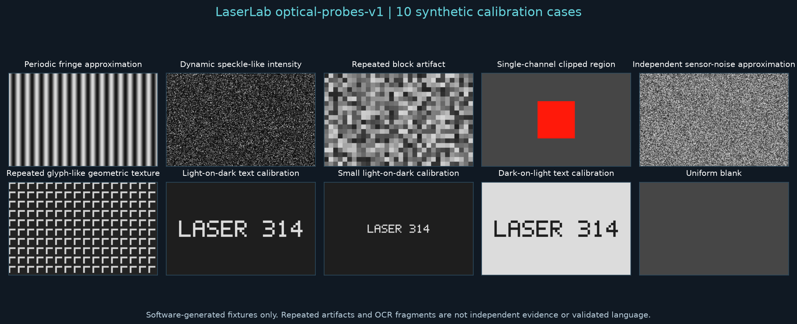

# Deterministic optical probes

Development source includes the offline `optical-probes-v1` benchmark. It exercises shared feature functions with **10 synthetic cases**, three frames per case and four preprocessing probes: original, Gaussian blur, JPEG quality 35, and blur followed by JPEG. No empirical captures, community recordings, external fonts or downloads are included. Existing native v0.8.2 downloads do not include the benchmark command; this work does not publish a release.



Generate into a new directory, then evaluate into a new report path:

```text
python -m laserlab.cli benchmark generate --output experiments/optical-probes
python -m laserlab.cli benchmark run --pack experiments/optical-probes --output experiments/optical-probes-report.json
```

For a future native bundle the same commands use `LaserLabCLI` instead of `python -m laserlab.cli`. Ordinary demo use is unchanged. The generated pack is about 2 MB on the reference stack; repeated frames and preprocessing derivatives are correlated and are never independent experiments.

## Truth and provenance

The public [reference manifest](../sample_media/optical_benchmark_reference.json) records each design, license, seed, frame count, task-specific truth, raw/processed file SHA-256, decoded-pixel SHA-256, transformation settings and generator/library versions. The reference stack is recorded in that file. PNG/JPEG bytes and some transformed pixels can vary with library versions; use the recorded stack for exact replay. Raw pixel hashes provide a separate check from image encoding.

The original generated arrays and geometric 5x7 calibration glyphs are distributed under this repository's MIT license. Existing public optical clips retain their original attribution and licenses and are explicitly typed **demonstration**. No rights-cleared real matched research fixture is currently supplied. Unconfirmed external redistribution remains disabled.

| Case | Exact design / purpose | Intentionally inserted text |
| --- | --- | --- |
| Fringes | Stationary 16-pixel integer cosine-like fringe approximation | No |
| Speckle | Dynamic pseudorandom exponential-like intensity approximation | No |
| Compression blocks | Repeated 8x8 constant block artifact | No |
| Saturated patch | Stationary rectangle clipped in one color channel | No |
| Sensor noise | Independent uniform pseudorandom grayscale frames | No |
| Static texture | Repeated geometric corners/checkers | No |
| Known text | Light geometric text on dark background, scale 4 | `LASER 314` |
| Small text | Light geometric text on dark background, scale 2 | `LASER 314` |
| Dark text | Dark geometric text on light background, scale 4 | `LASER 314` |
| Blank | Uniform stationary field | No |

These are deliberately simple approximations, not a complete physical optics or camera model. SHAKE-256 seeds the noise fields. The generator uses its own glyph definitions; it does not depend on installed fonts. If importing a case into the GUI for practice, declare it as a synthetic regression/calibration fixture, never as an empirical matched control.

Evaluation checks the canonical specification, typed provenance and ground truth, every file/pixel hash, frame dimensions and order, and replay of the raw generation and processed transformations. It rejects altered labels, duplicate cases, substituted content and paths outside the pack. A self-edited file plus a replacement hash cannot silently redefine the benchmark. Generation and CLI reporting preserve existing directories/files.

## Measurements and error counts

The report records rules and counts per variant. It has no evidence ladder, p-value, confidence interval, validated-language decision or pooled significance.

- **Text-like component screen:** shared `connected_components` with at least five text-like components. Positive truth means intentionally inserted calibration text, not that arbitrary glyph-like shapes are language. This is a candidate screen, not OCR or semantic validation.
- **Periodicity:** shared FFT peak prominence at least 8, matching the existing scientific calibration threshold. Only explicitly periodic/nonperiodic designs are scored. Ambiguous artifacts and text cases have unknown periodicity truth and are excluded from error denominators.
- **Pixel clipping:** fraction of pixels with any channel at least 250/255, threshold 2%. Known truth is scored for the original probe only; blur/encoding can change clipping and their pixel truth is left unknown. This is not a calibrated sensor-saturation test.
- **Frame persistence:** the actual pipeline's Otsu-mask overlap over three frames, threshold .8. Per-probe sensitivity at .5, .8 and .95 is also recorded. A stationary compression artifact can score 1.0 without establishing independent replication or text.
- **Optional OCR:** one full-frame request on the first frame of each case/variant. This scope does not benchmark the full ROI search pipeline. Nonempty alphanumeric OCR on no-text cases is counted as a false response; exact normalized calibration-text matches are recorded separately. No dictionary or meaning is inferred.

Feature functions other than clipping/persistence use the first frame. Rates describe only finite known-truth probes. Every summary includes evaluated positive/negative denominators, unknown-truth exclusions and unavailable predictions. Unknown truth is never converted into a negative label. Do not interpret the error counts as real-world accuracy, calibrated FDR, independent statistical replicates or performance on unlicensed public clips.

The committed [golden baseline](../tests/golden/optical_benchmark.json) intentionally includes existing failures. On the reference original probes, the component screen flags sensor noise and misses both light-on-dark text cases, while detecting the dark-on-light case. The periodicity screen misses the repeated corner texture. Blur introduces additional component-screen false positives. Keep these observations visible; a deliberate detector improvement should update the baseline with an explanation, not silently redefine ground truth or tune scores to produce a clean result.

## Optional real OCR

OCR is off by default. To evaluate an already-installed Tesseract available on PATH:

```text
python -m laserlab.cli benchmark run --pack experiments/optical-probes --output experiments/optical-probes-ocr.json --ocr tesseract
```

The Python API also accepts `TesseractAdapter(executable_path=...)` for an explicit local installation. Reports retain engine/version, settings, output and failures. Missing engines, errors, timeouts, and null text remain **not evaluated**; empty successful text is a valid negative prediction. Simulated OCR is used only in unit tests of accounting and adversarial review boundaries, not as a reported real engine result. No model service, credentials, upload or network access is required.

The committed [local reference observations](../sample_media/optical_benchmark_observations.json) used Tesseract **5.5.0.20241111**: all 12 calibration probes matched the inserted text exactly, while 15 of 28 no-text probes yielded nonempty alphanumeric output. These are correlated derivatives of ten designed cases, not independent experiments or real-world accuracy estimates. OCR output and engine/version are recorded so the failures remain inspectable; optional OCR is not given a portable engine-independent golden score.

Gaussian blur and JPEG probes use the documented [OpenCV smoothing](https://docs.opencv.org/4.x/d4/d13/tutorial_py_filtering.html) and [image codec APIs](https://docs.opencv.org/4.x/d4/da8/group__imgcodecs.html). Thresholds are declared software checks, not newly validated optical research methods.

## Packaging and saved experiments

Release smokes now run the bundled public demo through sealed analysis, explicit unblinding and local export from an unrelated temporary working directory. They also generate and evaluate the synthetic pack with the frozen CLI. The normal novice demo still uses its bundled files and requires no download. These headless checks supplement GUI startup checks; they do not establish native volunteer/field acceptance under issue #48.

This addition does not modify detector functions or existing scientific thresholds, reprocess saved experiments, change source media, or publish a native release. New `fixture_type` provenance distinguishes synthetic and demonstration assets. Synthetic fixtures remain excluded from empirical evidence even if a recording role is selected incorrectly. Existing reports and experiments remain preserved; the standalone benchmark has its own manifest/report version and does not migrate old results.
